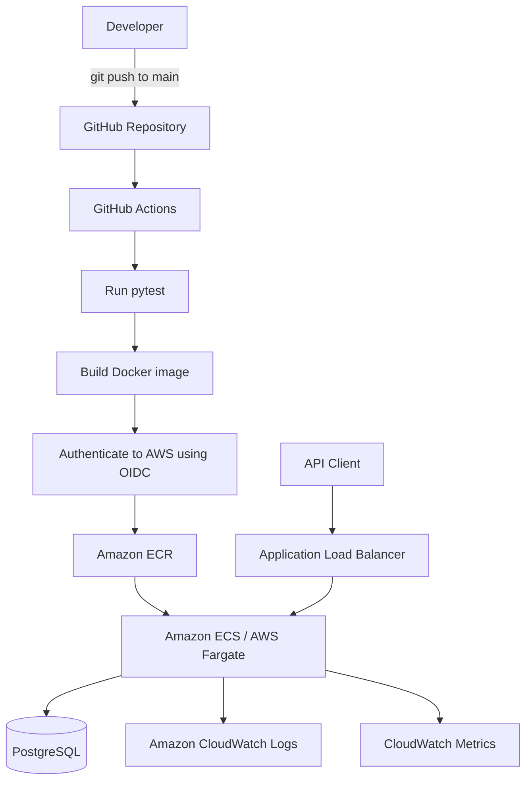

Cloud DevOps Task API
A containerized task-management REST API built with FastAPI and PostgreSQL, with a deployment workflow using Docker, Amazon ECR, Amazon ECS on AWS Fargate, Terraform, and GitHub Actions.

The project demonstrates an end-to-end cloud application workflow: develop locally, test, package the application into a Docker image, publish the image to a container registry, and deploy it to AWS through an automated CI/CD pipeline.
Project status: The application and deployment configuration are in progress. The Terraform configuration currently manages only part of the AWS foundation; it is not yet a complete, reproducible definition of every manually created AWS resource. Do not assume that the public deployment is currently healthy.

Architecture

The database connection is supplied to the ECS task through AWS Secrets Manager. The exact hosting location of the cloud database must match the DATABASE_URL secret. The repository's Docker Compose configuration runs PostgreSQL locally for development.
Features
- REST API for creating, listing, retrieving, updating, and deleting tasks.
- Request and response validation with Pydantic.
- SQLAlchemy-based database access.
- PostgreSQL for persistent task storage.
- Health-check endpoint at /health.
- Local development environment using Docker Compose.
- Docker image built from a Python slim base image.
- Automated tests with pytest.
- Container image storage in Amazon ECR.
- ECS Fargate deployment behind an Application Load Balancer.
- GitHub Actions workflow for CI/CD.
- AWS authentication from GitHub Actions using OpenID Connect (OIDC), avoiding long-lived AWS access keys.
- Terraform configuration for selected AWS resources.
- CloudWatch container logging.
Technology Stack
Area	Technology
API	Python, FastAPI
Validation	Pydantic
ORM / database access	SQLAlchemy
Database	PostgreSQL
Python dependency management	uv
Testing	pytest, HTTPX
Containerization	Docker, Docker Compose
Container registry	Amazon ECR
Container runtime	Amazon ECS with AWS Fargate
Load balancing	Application Load Balancer
Infrastructure as Code	Terraform, AWS provider
CI/CD	GitHub Actions
AWS authentication	IAM role with GitHub OIDC
Logging and monitoring	Amazon CloudWatch

Project Structure
cloud-devops-project/
├── .github/
│   └── workflows/
│       └── deploy.yml          # Test, build, push, and deploy workflow
├── src/
│   └── cloud_devops_project/
│       ├── main.py             # FastAPI application and API routes
│       ├── models.py           # Pydantic request/response schemas
│       ├── database.py         # SQLAlchemy engine and Base
│       ├── db_models.py        # SQLAlchemy database models
│       ├── dependencies.py    # Shared FastAPI dependencies
│       └── storage.py         # Database operations for tasks
├── terraform/
│   ├── versions.tf            # Terraform and AWS provider versions
│   ├── variables.tf           # Terraform input variables
│   ├── main.tf                # Selected AWS resources
│   ├── outputs.tf             # Terraform outputs
│   └── terraform.tfvars       # Local variable values (do not commit secrets)
├── tests/                     # Automated tests
├── ecs-task-definition.json   # ECS task definition template
├── Dockerfile
├── docker-compose.yml
├── .dockerignore
├── .gitignore
├── pyproject.toml
├── uv.lock
└── README.md
Some filenames may change as the project evolves. Keep this tree synchronized with the repository.
API
The API currently exposes the following endpoints:
Method	Endpoint	Description
GET	/health	Check whether the API process is responding
POST	/tasks	Create a task
GET	/tasks	List all tasks
GET	/tasks/{task_id}	Retrieve one task
PUT	/tasks/{task_id}	Update a task
DELETE	/tasks/{task_id}	Delete a task

Task model
A task contains:
Field	Description
id	Database-generated task identifier
title	Required title, 1–100 characters
description	Optional description, up to 500 characters
status	todo, in_progress, or done
created_at	Creation timestamp

Example requests
Create a task:
curl -X POST http://localhost:8000/tasks \
  -H "Content-Type: application/json" \
  -d '{
    "title": "Build cloud deployment",
    "description": "Deploy the FastAPI service to ECS"
  }'
List tasks:
curl http://localhost:8000/tasks
Retrieve a task:
curl http://localhost:8000/tasks/1
Update a task:
curl -X PUT http://localhost:8000/tasks/1 \
  -H "Content-Type: application/json" \
  -d '{
    "status": "in_progress"
  }'
Delete a task:
curl -X DELETE http://localhost:8000/tasks/1
Interactive API documentation is available at /docs when the application is running.
Local Development
Prerequisites
- Python version compatible with pyproject.toml
- uv
- Docker Desktop with Docker Compose
- Git
1. Clone the repository
git clone https://github.com/Paul1231231/cloud-devops-project.git
cd cloud-devops-project
2. Install dependencies
uv sync --locked --dev
3. Configure the database password
Create a local .env file (do not commit it):
POSTGRES_PASSWORD=replace-with-a-local-password
4. Start the API and PostgreSQL
docker compose up --build
The API is available at:
- API: http://localhost:8000
- Health check: http://localhost:8000/health
- Swagger UI: http://localhost:8000/docs
Stop the containers:
docker compose down
To also delete the local PostgreSQL volume and all local database data:
docker compose down -v
docker compose down -v deletes the local development database volume. Use it only when you are comfortable losing local test data.

Run the API without Docker
If you have a PostgreSQL instance available and have configured the database connection expected by the application:
uv run uvicorn cloud_devops_project.main:app --reload
Testing
Install development dependencies and run:
uv sync --locked --dev
uv run pytest
The GitHub Actions workflow runs the test suite before the deployment job.
Docker
Build the image:
docker build -t cloud-devops-task-api:local .
Run it only when a reachable PostgreSQL database and the required DATABASE_URL configuration are available:
docker run --rm -p 8000:8000 \
  -e DATABASE_URL="your-database-connection-string" \
  cloud-devops-task-api:local
Do not put real database credentials into shell history, source control, or a public README.
AWS Deployment
The intended deployment path is:
1. GitHub Actions checks out the repository.
2. The test job installs dependencies and runs pytest.
3. The deployment job obtains temporary AWS credentials using GitHub OIDC.
4. GitHub Actions builds the Docker image and tags it with the Git commit SHA.
5. The image is pushed to Amazon ECR.
6. The workflow renders a new ECS task definition using the pushed image.
7. ECS deploys the new task definition revision to the service.
8. The Application Load Balancer routes HTTP traffic to healthy ECS tasks.
AWS resources used by this project
The deployment configuration has used the following resource names in the ap-northeast-1 region:
Resource	Name
ECR repository	cloud-devops-task-api
ECS cluster	cloud-devops-cluster
ECS service	cloud-devops-task-api
ECS task definition family	cloud-devops-task-api
Container name	cloud-devops-task-api
Application Load Balancer	cloud-devops-api-alb
Target group	cloud-devops-api-tg
CloudWatch log group	/ecs/cloud-devops-task-api
Secrets Manager secret	cloud-devops-task-api/database-url (secret ARN suffix is AWS-generated)

These are configuration references, not a guarantee that every resource currently exists or is healthy.
GitHub Actions configuration
The workflow is located at:
.github/workflows/deploy.yml
It is configured to run on pushes to main and manual workflow dispatch.

Configure these repository variables under GitHub → Settings → Secrets and variables → Actions → Variables:
Variable	Description
AWS_REGION	ap-northeast-1
AWS_ROLE_ARN	ARN of the GitHub Actions deployment role
ECR_REPOSITORY	cloud-devops-task-api
ECS_CLUSTER	cloud-devops-cluster
ECS_SERVICE	cloud-devops-task-api
ECS_TASK_DEFINITION	ecs-task-definition.json
CONTAINER_NAME	cloud-devops-task-api

The GitHub OIDC IAM role trust policy should restrict access to this repository and the intended branch. The deployment role should have only the permissions required to push to the specific ECR repository, register task definitions, update the ECS service, and pass the ECS task roles.

The ECS task execution role is separate from the GitHub Actions deployment role. It is used by ECS to pull images, publish logs, and retrieve configured secrets.
Terraform
Terraform currently defines selected infrastructure, including:
- Security groups for the ALB, API and database.
- An ECS cluster.
- A CloudWatch log group.
- Data sources for the default VPC and its subnets.
Terraform is not yet the complete source of truth for the deployment. The ECS service, load balancer, target group, task definition, IAM roles, secret and all networking dependencies may have been created separately. Import and reconcile existing resources before applying changes or destroying infrastructure.

Example commands:
cd terraform
terraform init
terraform fmt -check
terraform validate
terraform plan
Review the plan carefully. Do not run terraform apply or terraform destroy until you understand which real AWS resources the configuration manages.
Monitoring and Troubleshooting
CloudWatch Logs
The ECS task sends container logs to:
/ecs/cloud-devops-task-api
Tail recent logs:
aws logs tail /ecs/cloud-devops-task-api \
  --region ap-northeast-1 \
  --since 1h \
  --follow
ECS service status
aws ecs describe-services \
  --cluster cloud-devops-cluster \
  --services cloud-devops-task-api \
  --region ap-northeast-1 \
  --query 'services[0].{Desired:desiredCount,Running:runningCount,Pending:pendingCount,Events:events[0:5]}' \
  --output json
Target health
aws elbv2 describe-target-health \
  --target-group-arn YOUR_TARGET_GROUP_ARN \
  --region ap-northeast-1
If the ALB returns HTTP 503 and the target group has no healthy targets, first check whether ECS has successfully launched a task. An ALB cannot route requests to a task that is not running and registered as a target.
Security Practices
- Use GitHub OIDC to obtain short-lived AWS credentials instead of storing long-lived AWS access keys in GitHub.
- Keep database connection strings in AWS Secrets Manager rather than committing them to Git.
- Restrict IAM permissions to the resources and actions required by each role.
- Keep the ECS task execution role separate from the GitHub Actions deployment role.
- Restrict inbound security-group rules to the required ports and sources.
- Never commit .env, Terraform state, terraform.tfvars containing secrets, or AWS credentials.
- Avoid exposing database ports directly to the public internet.
Cost Management
AWS resources can continue to incur charges even when the API receives no traffic. In particular, review:
- Application Load Balancers.
- Running Fargate tasks.
- NAT Gateways.
- RDS databases, if any were created.
- Public IPv4 addresses and unused Elastic IPs.
- VPC endpoints.
- CloudWatch log ingestion and retention.
- ECR image storage.
- Secrets Manager secrets.
When the deployment is not being used, stop or delete billable resources that are no longer needed. Deleting an ECS service does not automatically delete its load balancer, target group, ECR repository, CloudWatch log group, or Secrets Manager secret.

Before cleanup, inspect the resources in the AWS region and check the AWS Billing console. Preserve any database or other data you want to keep.
Future Improvements
- Complete the Terraform configuration so the infrastructure is reproducible.
- Add Terraform remote state and state locking.
- Add HTTPS using ACM and an appropriate domain.
- Add CloudWatch alarms and SNS notifications.
- Add structured JSON application logs and request IDs.
- Add database migrations with Alembic.
- Add API pagination and more comprehensive integration tests.
- Add deployment rollback and health-check validation.
- Add automated cost alerts and resource cleanup procedures.
Learning Outcomes
This project provides hands-on practice with:
- Building and testing a REST API.
- Connecting an application to PostgreSQL.
- Containerizing an application with Docker.
- Publishing container images to ECR.
- Deploying containers using ECS Fargate.
- Configuring load balancing and health checks.
- Managing infrastructure with Terraform.
- Building CI/CD pipelines using GitHub Actions.
- Using OIDC for secure AWS authentication.
- Monitoring and troubleshooting cloud workloads with CloudWatch.
- Understanding AWS cost and resource lifecycle management.
